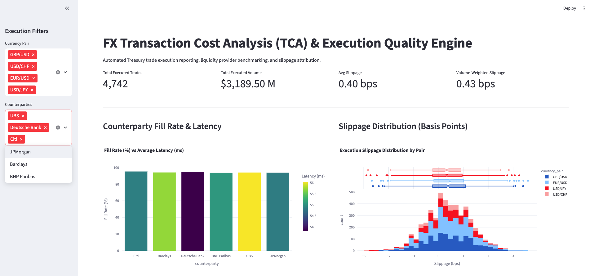
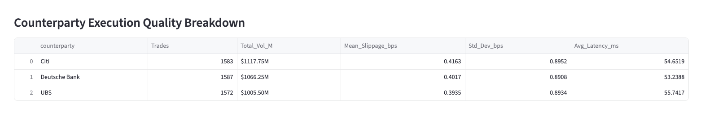

# FX Transaction Cost Analysis (TCA) & Execution Quality Engine

An institutional-grade Transaction Cost Analysis (TCA) framework designed for Treasury and multi-asset execution desks. This application ingests high-frequency trade execution data, stores it securely in a relational database, and computes key execution performance metrics across liquidity providers.



## Business Use Case

In fast-paced trading environments, treasury desks must constantly evaluate the quality of their execution to minimize slippage and manage counterparty risk. This automated engine replaces manual spreadsheet reconciliation by providing front-office operations with immediate, actionable intelligence. 

The engine specifically solves the following operational challenges:
*   **Implementation Shortfall Tracking:** Measures the exact cost of market impact and slippage in basis points (bps) against arrival price benchmarks.
*   **Liquidity Provider Benchmarking:** Evaluates counterparty fill efficiency, rejection rates, and execution latency to optimize future routing decisions.
*   **Automated Reporting:** Eliminates manual data mining by structuring raw trade logs into a queryable SQLite database linked to an interactive visualization layer.

## Key Features & Visualizations

The analytical dashboard, built with Streamlit and Plotly, allows users to filter execution data dynamically by currency pair and counterparty.


*   **Slippage Distribution:** A histogram mapping adverse price selection across different currency pairs, identifying outlier trades that require operational investigation.
*   **Fill Rate vs. Latency:** A multi-variable chart tracking the reliability of liquidity providers by comparing their successful execution rates against their average system latency.



*   **Execution Quality Breakdown:** An automated data table calculating Volume-Weighted Average Price (VWAP) spreads, highlighting the most cost-effective counterparties for high-volume transactions.

## Tech Stack

*   **Data Engineering:** Python (Pandas, NumPy), SQLite, SQLAlchemy
*   **Analytics & Frontend:** Plotly, Streamlit
*   **Architecture:** Multi-threaded data ingestion, ACID-compliant local storage, responsive web framework.

## Quickstart Guide

1. Clone the repository to your local machine:
   ```bash
   git clone [https://github.com/your-username/fx-tca-engine.git](https://github.com/your-username/fx-tca-engine.git)
   cd fx-tca-engine